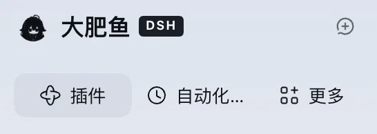

# dsh-compact-panel-nav

[](https://www.npmjs.com/package/dsh-compact-panel-nav) [](LICENSE)

A DeepSeek Harness Web UI plugin that compacts the top of the sidebar: **Plugins / Automations / More** collapse from three stacked rows into one, and **New Session** leaves its own full-width row to become an icon at the right end of the brand row. Together that returns about **130px** to the workspace list.

压缩侧边栏顶部的 DeepSeek Harness 客户端插件：「插件 / 自动化任务 / 更多」三行合并成一行，「新会话」从整行按钮收成图标放到品牌行最右侧 —— 一共给下面的工作区列表腾出约 130px 高度。



---

## What it does / 它做了什么

- **Expanded sidebar**: the three panel rows become a single 32px row of three equal cells, icon + label centered.
- **New Session** leaves the flow and becomes a 28×28 icon-only control at the right end of the brand row, same size as the sidebar toggle. Its tooltip keeps the accessible name and the `⌘N` hint.
- **Collapsed 56px rail**: untouched — the navigation keeps its vertical icon stack, and New Session returns to its shipped place in the rail.
- Everything else stays as shipped: the brand identity, row order, hover/active states, focus rings, keyboard access, and the More menu.

- **展开态**：三行合成一行，32px 高、三等分、图标与文字居中。
- **新会话**：离开文档流，变成品牌行最右端的 28×28 纯图标控件（与右上角收起按钮同规格），tooltip 里仍然有「新建会话 ⌘N」。
- **收起态（56px 图标栏）**：完全不动 —— 导航保持竖排图标，新会话回到它在窄栏里的原位。
- 其余一律不动：品牌标识、顺序、hover/选中态、焦点样式、键盘可达性、More 菜单。

## How it works / 实现方式

**Navigation — CSS only.** The rules target the navigation landmark by its accessible name, which the sidebar derives from its own `panels.label` dictionary (`全局面板` in the shipped Chinese locale, `Global panels` in English). A `:has()` guard requires an icon + title pair inside a row, which only the expanded sidebar renders, so the collapsed rail keeps its original layout.

**New Session — no reparenting.** The button stays where React put it; the script only switches that one element to `position: absolute`, measures the brand strip once against the button's own parent, and writes the geometry (28×28, vertically centered, right-aligned) inline. Nothing is written onto the brand row or any other node, so a measurement can never squeeze the brand identity.

Every precondition is checked before anything is touched: expanded sidebar, the button is the sibling immediately before the nav, the strip above it is a `div` that holds no button of its own (that rejects the macOS window-control strip), and the button contains an icon. If any check fails, the button is left exactly as shipped. Collapsing the sidebar or disabling the plugin restores the saved inline style text.

The icon-only look — hiding the label and the inline `⌘N` hint, plus the hover background in theme tokens — is scoped to a data attribute the script sets, so it can never style an unrelated element.

**导航行 —— 纯 CSS。** 选择器只认导航容器的无障碍名称（侧边栏自己的 `panels.label`：中文「全局面板」、英文「Global panels」），再用 `:has()` 判断行内是否出现「图标 + 标题」——只有展开态成立，因此收起态保持原样。

**新会话 —— 不搬家。** 按钮仍在 React 放的位置，脚本只把这一个元素改成 `position: absolute`，以**它自己的父元素**为基准量一次品牌行，把几何值（28×28、垂直居中、右对齐）写成内联样式。品牌行与其它任何节点的内联样式一个都不碰，所以「量错就把品牌挤没」那种事故在结构上不可能发生。

动手前逐条校验：必须展开态、按钮必须是导航前一个兄弟、它上面那条必须是「自身不含 button」的 div（用来排除 macOS 窗口控制条）、按钮里必须有图标。任一条不成立就原样保留。收起侧边栏或停用插件时，恢复此前保存的 `cssText`。

「只留图标」这件事（隐藏文字与 inline `⌘N`、hover 底色、主题变量配色）都挂在脚本自己写的 data 属性上，不会误伤别的元素。

## Install / 安装

This is a profile bundle: a package whose `package.json` declares `dsh.bundle.patch`, with a `./client` module for the browser half. It is published on npm as [`dsh-compact-panel-nav`](https://www.npmjs.com/package/dsh-compact-panel-nav), so there are two routes.

**From npm (no clone).** Install the published package into the profile, then make sure it is enabled in **Settings → Plugins**:

```bash
dsh plugin --profile web add dsh-compact-panel-nav
```

The same step through the Harness agent does install and bundle selection in one call:

```
plugin_manager  action=install_bundle  target=dsh-compact-panel-nav
```

**From this repository (the route verified here).**

1. Clone it somewhere stable (the profile links the directory — moving or deleting it breaks the plugin).

   ```bash
   git clone https://github.com/dyguests/dsh-compact-panel-nav.git
   ```

2. Install the bundle into the current Harness profile. Ask the Harness agent to install this directory as a bundle — the plugin manager call is `install_bundle` with the cloned directory as its target:

   ```
   plugin_manager  action=install_bundle  target=/absolute/path/to/dsh-compact-panel-nav
   ```

   It installs the package, selects the bundle in the profile and activates it; the profile then references the directory by link.

3. Check **Settings → Plugins** for the bundle — title *Compact Sidebar Nav* / 侧边栏导航压缩. It applies immediately; if the sidebar does not change, reload the page once (`Cmd+R`).

这是一个 profile bundle（`package.json` 里声明 `dsh.bundle.patch`，浏览器侧由 `./client` 模块提供），已发布到 npm：[`dsh-compact-panel-nav`](https://www.npmjs.com/package/dsh-compact-panel-nav)。

- **走 npm（不用 clone）**：`dsh plugin --profile web add dsh-compact-panel-nav`，装完在「设置 → 插件」里确认启用；或者让 agent 调 `install_bundle`，target 直接写包名，一步完成安装 + 启用。
- **走本仓库（这里验证过的方式）**：clone 到固定位置后，`install_bundle` 的 target 写该目录的绝对路径；profile 是通过 link 引用它的，别删目录。

装完即时生效，不生效就刷新一次页面。

## Compatibility and known limits / 兼容性与已知限制

- Verified on DeepSeek Harness **0.2.1-rc.3** (Desktop, macOS), Chinese UI.
- Depends on the accessible name of the panel nav (`全局面板` / `Global panels`). A future release that renames that label, or a third UI language, makes the plugin a no-op instead of breaking the layout.
- The New Session move expects the macOS brand strip: a drag strip above the button that holds no button of its own. Where the brand row is itself a button (the Windows/Linux layout), that check fails on purpose and only the one-row navigation applies.
- Cells are equal thirds, so on a very narrow sidebar a long label (e.g. 自动化任务) ellipsizes. Widen the sidebar to see it in full.
- Values use theme tokens (`--dsw-radius-*`, `--dsw-alias-*`), so light and dark themes both follow the host.

- 在 DeepSeek Harness **0.2.1-rc.3**（桌面端 / macOS、中文界面）上验证。
- 依赖导航容器的无障碍名称；将来改文案或换成第三种语言时，插件会「不生效」而不是把布局弄坏。
- 「新会话进品牌行」依赖 macOS 的品牌条形态（按钮上方是一条自身不含 button 的拖拽条）。Windows/Linux 的品牌行本身是按钮，该项校验会按设计失败 —— 那里只生效「一行导航」。
- 三等分单元格：侧边栏很窄时较长文案（如「自动化任务」）会省略；拉宽即可完整显示。
- 配色走主题变量，深/浅色模式都跟随宿主。

## Uninstall / 卸载

Disable or remove the bundle from the plugin list. The stylesheet is removed with it and the script restores the button's saved inline style, so the sidebar returns to three stacked rows with the full-width New Session button.

在插件列表里停用或移除即可：样式表随之移除，脚本把按钮的内联样式还原，侧边栏恢复三行 + 整宽的新会话按钮。

## Version history / 版本

- **1.3.2** — Docs only: npm badge, the `dsh plugin … add` install command, and [`docs/hub-submission.md`](docs/hub-submission.md) for the DSH Plugin Hub listing. No runtime change.
- **1.3.1** — New Session is now an icon-only control in the brand row. 1.3.0 placed it there but left the inline `⌘N` hint visible, which competed with the icon inside 28px and clipped both; 1.3.1 hides that hint (the tooltip still lists the keys) and makes the icon container fill the button.
- **1.2.0** — Reverted an experiment that moved New Session by padding the brand row from a measurement; the padding squeezed the brand identity to zero width. Back to CSS-only for the navigation, plus a one-time cleanup of that experiment's leftovers.
- **1.0.0** — First release: the three panel rows become one row.

- **1.3.2** — 仅文档：npm 徽章、`dsh plugin … add` 安装命令，以及给 DSH Plugin Hub 用的 [`docs/hub-submission.md`](docs/hub-submission.md)。运行时无改动。
- **1.3.1** — 「新会话」收成品牌行里的纯图标控件。1.3.0 已经放到位，但没隐藏 inline `⌘N` 提示：它和图标一起挤 28px，两者都被裁掉；1.3.1 隐藏该提示（tooltip 仍列快捷键），并让图标容器铺满按钮。
- **1.2.0** — 撤回「按测量给品牌行加 padding」的那版实验（那次把品牌标识挤成 0 宽）。导航回到纯 CSS，并附带一次性清理残留。
- **1.0.0** — 首个版本：三行合并为一行。

## License

MIT — see [LICENSE](LICENSE).
